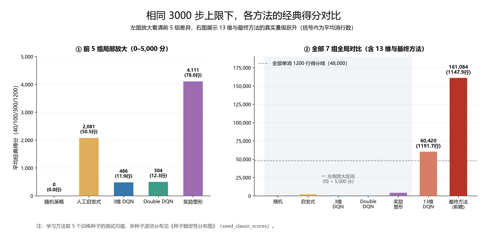
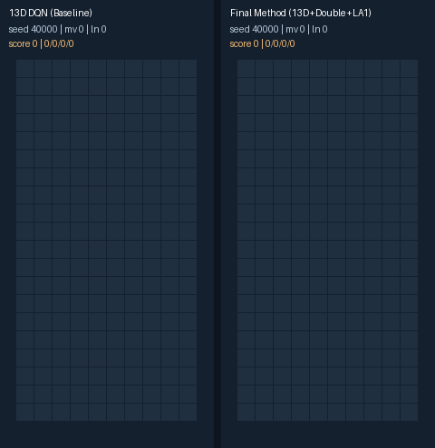

# Tetris 强化学习：基于 Afterstate 与 1 步前瞻的落点策略

本项目基于 [Tetris Gymnasium](https://github.com/Max-We/Tetris-Gymnasium) 0.3.1（`20×10` 棋盘），将俄罗斯方块建模为落点决策 MDP（每步从旋转 × 列位置共 40 个候选中选择落点），系统对比了基线策略、状态表示、算法改进、奖励设计与 **1 步前瞻搜索** 的效果。

除了平均消行数，评估统一采用 **经典俄罗斯方块得分**（一次消 `1/2/3/4` 行分别计 `40/100/300/1200` 分），用来区分“同样能活满 3000 步，谁能主动攒多连消拿高分”。

---

## 核心结果（3000 块上限 · 100 局独立测试）

每种学习方法均在训练种子 `0–4` 上各训练 `100,000` 步，并在相同的 100 个测试序列（种子 `40000–40099`）上评估；下表为 5 个训练种子的均值汇总（详细逐局数据见 [results/v2/summary.csv](results/v2/summary.csv)）。

| 方法 | 平均经典得分 | 平均消行数 | 3000 块存活率 | 每局 1 / 2 / 3 / 4 连消次数 | 作用说明 |
|---|---:|---:|---:|---:|---|
| 随机策略 | 0.4 | 0.01 | 0.0% | 0.0 / 0.0 / 0.0 / 0.0 | 性能下限 |
| 人工启发式 | 2,081.4 | 50.51 | 0.0% | 46.8 / 1.7 / 0.1 / 0.0 | 固定规则基线 |
| 3 维 DQN | 486.4 | 11.89 | 0.0% | 11.1 / 0.4 / 0.0 / 0.0 | 基准配置 |
| Double DQN（3 维） | 504.0 | 12.28 | 0.0% | 11.4 / 0.4 / 0.0 / 0.0 | 仅改算法：底座太弱时无改善 |
| 奖励塑形 DQN（3 维） | 4,111.2 | 78.05 | 0.2% | 58.1 / 6.8 / 1.3 / 0.6 | 方差极大（纯势函数基线为 `2,925.4` 分） |
| 13 维 DQN | 60,420.1 | **1,191.69** | **98.8%** | 615.4 / 245.7 / 23.8 / 3.4 | 补齐 10 列高度，主要保命消单/双行 |
| *最终方法（不开前瞻，消融）* | *74,018.6* | *808.54* | *42.6%* | *279.7 / 114.8 / 64.1 / 26.8* | *长视野+经典奖励学会留槽，但易翻车* |
| **最终方法（13 维 Double + $\gamma=0.99$ + 1 步前瞻）** | **161,083.7** | 1,147.94 | 93.0% | 208.7 / 118.3 / 116.5 / **88.3** | **经典得分达原 13 维的 2.67 倍** |

**核心结论**：
1. **状态表示决定生存上限**：3 维全局统计产生严重状态混叠（~12 行）；加入 10 列各自高度扩为 13 维后，平均消行直接升至 `1,191.69` 行（逼近 3000 块理论上限 1200 行）。
2. **长视野经典奖励 + 1 步前瞻协同爆发**：长视野（$\gamma=0.99$）+ Double DQN + 经典连消权重让模型学会蓄力四连消，但缺少下一块信息容易翻车（存活 `42.6%`）；加入 **1 步前瞻** 后，存活率恢复到 **`93.0%`**，每局四连消从 `3.4` 次暴涨到 **`88.3` 次**，经典得分跃升至 **`161,083.7` 分**。

---

## 效果图与动画演示



**同局 500 块实况对比（左：13 维 DQN 基准 `10,360` 分 · 右：最终方法 `35,780` 分、打出 23 次四连消）**：



- **全套新版图表与视频素材**：[results/v2/README.md](results/v2/README.md)（含前 5 组同屏动画、全 7 组棋盘对比、连消构成图、消融图）
- **给队员的讲解与答辩笔记**：[report/final_summary.md](report/final_summary.md)
- **中期实验原始存档（保留未改动）**：[results/final/README.md](results/final/README.md) · [report/results.md](report/results.md)

---

## 原理与决策流程

```text
当前方块 + 棋盘
   │
   ▼  ① 枚举 40 个候选落点（4 旋转 × 10 列，屏蔽越界动作）
   │
   ▼  ② 引擎并行模拟得到 afterstate（落子消行后的新棋盘）与即时奖励 r
   │
   ▼  ③ 价值网络 V(afterstate) 估计后续长期收益（MLP: 64-64-1，Huber loss）
   │
   ├── 无前瞻模式：选 r + γ·V(afterstate) 最大的落点
   │
   └── 1 步前瞻模式（--lookahead 1）：读取预告的下一块 queue[0]，枚举两步连招
         选 r1 + γ · max[ r2 + γ·V(afterstate2) ] 最大的当前落点
```

**配置文件说明**（`configs/` 下的单配置会自动合并 `configs/common.yaml`）：

| 配置文件 | 算法 | 特征维度 | $\gamma$ | 说明 |
|---|---|---:|---:|---|
| `configs/dqn.yaml` | DQN | 3 维 | 0.95 | 基础 3 维对比基准 |
| `configs/double_dqn.yaml` | Double DQN | 3 维 | 0.95 | 缓解 Q 值高估 |
| `configs/dqn_shaped.yaml` | DQN + 奖励塑形 | 3 维 | 0.95 | 加入势函数差分奖励 |
| `configs/dqn_features13.yaml` | DQN | 13 维 | 0.95 | 加入 10 列各自高度 |
| `configs/final_classic_double.yaml` | Double DQN | 13 维 | 0.99 | 最终方法（经典连消奖励，测试配合 `--lookahead 1`） |

---

## 快速上手：照着命令即可运行

### 第 0 步：环境安装与自检（Windows PowerShell，Python ≥ 3.10）

```powershell
git clone https://github.com/Hefeng13/tetris-rl.git
cd tetris-rl

python -m venv .venv
.\.venv\Scripts\python.exe -m pip install -r requirements-lock.txt
.\.venv\Scripts\python.exe -m pip install -e . --no-deps
.\.venv\Scripts\python.exe -m pytest -q
```

看到 `32 passed`（无 GPU 时会有 `1 skipped`）即表示环境就绪。每次新开终端先激活环境：

```powershell
.\.venv\Scripts\Activate.ps1
```

*(若提示“禁止运行脚本”，先执行 `Set-ExecutionPolicy -Scope Process Bypass`。)*

---

### 第 1 步：10 秒冒烟测试（确认整条链路能跑通）

```powershell
python -m tetris_rl.train --config configs/final_classic_double.yaml `
    --steps 2000 --validation-episodes 3 --test-episodes 3 --evaluation-cap 200 `
    --output runs/smoke_test
```

---

### 第 2 步：单独训练或直接评估已有模型

**训练单个配置**（例如训练最终方法种子 0，默认 100,000 步，CPU 约 8 分钟）：

```powershell
python -m tetris_rl.train --config configs/final_classic_double.yaml --seed 0 --output runs/my_final_s0
```

**直接评估已训练好的模型（推荐使用仓库自带模型，开 1 步前瞻）**：

```powershell
# 用仓库自带的最终模型开启 1 步前瞻，先测试 5 局看看效果
python -m tetris_rl.evaluate --policy dqn --lookahead 1 --episodes 5 `
    --checkpoint runs/v2_final/final_classic_double_seed0_attempt1/best.pt `
    --output results/my_final_check

# 对比基线（random | heuristic | potential）
python -m tetris_rl.evaluate --policy heuristic --output results/my_heuristic
python -m tetris_rl.evaluate --policy potential --output results/my_potential
```

---

### 第 3 步：一键复现全套图表与对比视频

仓库已经保存了 `runs/formal_v1` 和 `runs/v2_final` 的全部训练模型，可以直接一键重跑评估、作图和视频生成（请输出到新目录，勿覆盖冻结目录）：

```powershell
# 1. 多进程并行评估全部方法（输出汇总表 summary.csv 与逐局记录 episodes.csv）
python scripts/evaluate_v2.py --batch runs/formal_v1 --include-potential `
    --final-lookahead-dir runs/v2_final --output results/my_v2 --workers 8

# 2. 生成核心对比图（经典得分对比、连消结构、种子稳定性）
python scripts/plot_v2_results.py --results results/my_v2

# 3. 生成棋盘对比图与最终方法消融图
python scripts/plot_v2_boards_and_ablation.py `
    --final-checkpoint runs/v2_final/final_classic_double_seed0_attempt1/best.pt `
    --results results/my_v2

# 4. 生成前 5 组同屏、13维 vs 最终方法同屏、7合1及单人带分 GIF/MP4
python scripts/render_demo_v2.py `
    --final-checkpoint runs/v2_final/final_classic_double_seed0_attempt1/best.pt `
    --final-lookahead 1 --output results/my_v2/videos
```

---

## 目录结构

| 路径 | 说明 |
|---|---|
| `src/tetris_rl/env.py` | `PlacementEnv`：批量模拟 40 个候选落点，支持 `next_piece_candidates` 一步前瞻模拟与自定义奖励 |
| `src/tetris_rl/features.py` | 棋盘统计（各列高度、最高高度、空洞数、凹凸度）与 3/13 维特征提取 |
| `src/tetris_rl/network.py` | `QNetwork`：基于 `Q = r + γ·V(afterstate)` 分解的 MLP 估值网络 |
| `src/tetris_rl/agents/` | 智能体实现：`random_agent`、`heuristic_agent`、`potential_agent`、`dqn_agent`、`lookahead` |
| `src/tetris_rl/train.py` | 训练主循环：经验回放、目标网络同步、ε-greedy 探索与按验证集选检查点 |
| `src/tetris_rl/evaluate.py` | 统一评估入口：支持 `--lookahead 1`、经典得分与 `1/2/3/4` 连消统计 |
| `configs/` | `common.yaml` 共享参数 + 5 个实验配置 |
| `scripts/` | 批量训练、并行评估（`evaluate_v2.py`）、绘图与视频生成脚本 |
| `runs/formal_v1/` & `runs/v2_final/` | 冻结的中期 22 组产物与最终方法 5 种子模型（含 `best.pt`） |
| `results/final/` & `results/v2/` | 中期与终版完整实验数据表、图表和演示视频 |
| `report/` | 实验记录 [results.md](report/results.md) 与队员理解手册 [final_summary.md](report/final_summary.md) |
| `tests/` | 回归测试（环境与引擎一致性、TD 目标、前瞻二步等价性、经典得分核算等） |
