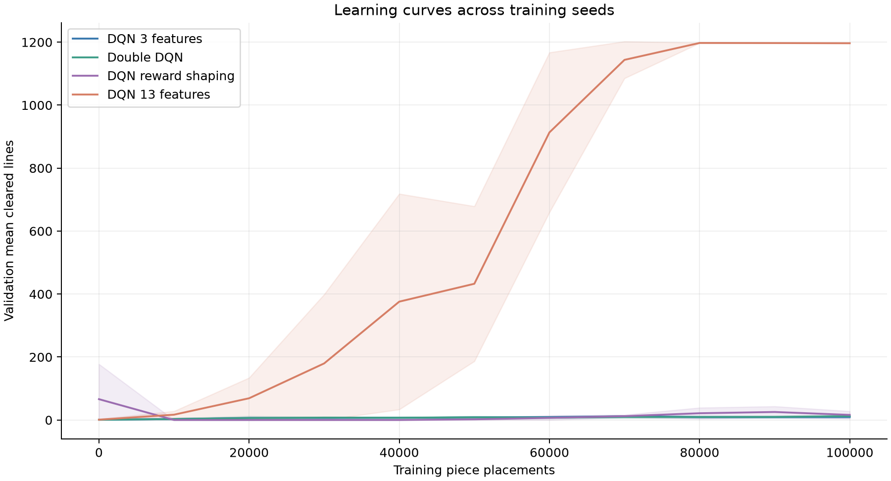
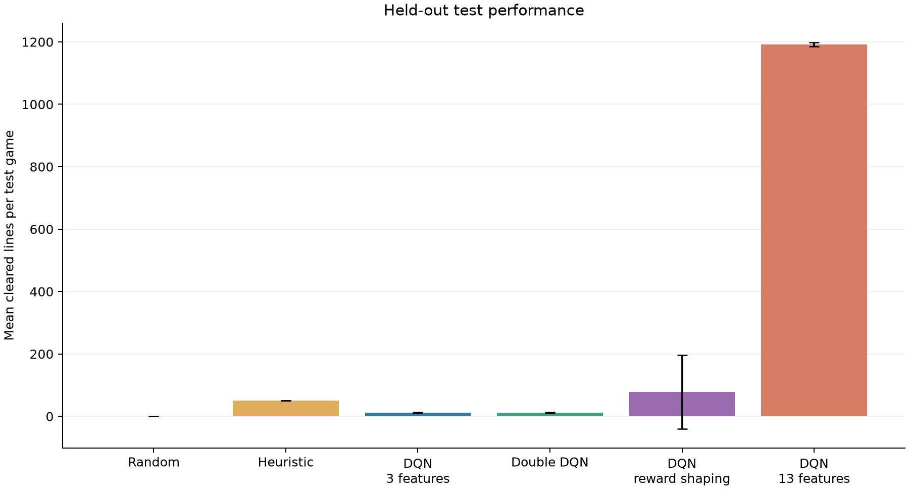

# 俄罗斯方块强化学习课程项目实验记录

生成时间为 2026-11-17 19:16，台北时间。

## 实验完成情况

已完成 4 个学习配置各 5 个训练种子，每次 100000 次落子，共 200 万次正式训练交互。另完成随机和启发式基线评估。每个模型在独立的 100 个测试种子上评估，正式测试记录共 2200 局。

13 项针对性回归检查通过，覆盖候选模拟与真实引擎的一致性、空棋盘消行、全部候选终止、截断 bootstrap、目标值计算、模型保存加载、验证随机性隔离及已知奖励计入。

## MDP 建模

| 元素 | 本项目定义 |
|---|---|
| 状态 S | 棋盘、当前方块、可见队列及出块过程相关状态，网络通过压缩特征观察局面 |
| 动作 A | 当前方块的旋转与横向落点，边框碰撞由合法动作 mask 约束 |
| 奖励 R | 本次落子的存活与消行奖励，游戏结束处罚，塑形组另加势函数差分 |
| 转移 P | 旋转、落子和消行由引擎计算，后续方块由 7-bag 过程产生 |
| gamma | 0.95，每次放置一个方块对应一个决策步 |
| 终止与截断 | 游戏结束为终止，达到人为设置的放块预算为截断 |

## 设置

- 环境为 Tetris Gymnasium 0.3.1，棋盘为 20×10，动作是旋转与列位置的 40 个候选槽位。
- 完整状态涉及棋盘、当前方块、队列和出块机制，网络使用压缩棋盘观测。
- 基础配置使用最高高度、空洞数和凹凸度。13 维配置额外使用 10 列高度。棋盘特征统一除以 10。
- 网络学习后续价值，动作评分为已知的一步学习奖励加 gamma 乘 afterstate 价值，终止候选的后续价值为 0。
- 基础奖励为存活 1 加消行数平方乘 10，游戏结束为 -10，学习时统一除以 10。
- gamma=0.95，Adam 学习率 0.001，batch=64，回放容量 20000，每 4 步更新，目标网络每 1000 步同步。
- 训练种子为 0 到 4，训练回合上限为 500 块。验证种子为 10000 到 10019，每 10000 步验证一次。
- 检查点按验证平均消行数选择，步数 0 的初始化模型也参与选择，并列时选较晚检查点。最终测试种子为 40000 到 40099，验证和测试上限均为 3000 块。
- 初期开发与预实验使用其他测试种子，正式测试发生在配置冻结后。
- 启发式固定为 -0.5×最高高度 -0.36×空洞数 -0.18×凹凸度 +本次消行数平方。
- 塑形势函数为 phi=-(0.05×最高高度+0.5×空洞数)，附加奖励为 gamma×phi(next)-phi(current)，终止势为 0。

## 正式结果

学习方法先计算每个模型的 100 局平均值，再对 5 个训练种子求均值和样本标准差。基线的 ± 表示 100 个测试回合之间的标准差。

| 方法 | 平均消行数 ± 标准差 | 平均落子决策次数 | 达到 3000 块上限比例 |
|---|---:|---:|---:|
| 随机策略 | 0.01 ± 0.10 | 18.43 | 0.0% |
| 固定启发式 | 50.51 ± 23.59 | 167.36 | 0.0% |
| 基础 DQN | 11.89 ± 1.22 | 57.39 | 0.0% |
| Double DQN | 12.28 ± 1.75 | 59.18 | 0.0% |
| DQN＋奖励塑形 | 78.05 ± 117.80 | 226.96 | 0.2% |
| DQN＋13 维棋盘特征 | 1191.69 ± 7.01 | 2985.52 | 98.8% |

落子决策次数包含导致终止的最后一次尝试，作为存活长度指标。

## 各训练种子的独立测试成绩

每个单元格为对应模型在 100 个固定测试种子上的平均消行数。

| 配置 | 种子 0 | 种子 1 | 种子 2 | 种子 3 | 种子 4 |
|---|---:|---:|---:|---:|---:|
| 基础 DQN | 11.58 | 13.25 | 11.47 | 12.92 | 10.24 |
| Double DQN | 13.00 | 13.62 | 12.84 | 12.75 | 9.21 |
| DQN＋奖励塑形 | 13.07 | 21.91 | 49.62 | 18.40 | 287.25 |
| DQN＋13 维棋盘特征 | 1186.14 | 1197.59 | 1194.70 | 1197.62 | 1182.39 |

## 训练前后验证表现

这里使用同一组 20 个验证种子。训练前为随机初始化网络的贪心策略，训练后为验证选择的检查点。模型选择使用了验证数据，最终泛化性能以独立测试表为依据。

| 配置 | 训练前平均消行数 | 所选检查点平均消行数 |
|---|---:|---:|
| 基础 DQN | 0.85 | 12.93 |
| Double DQN | 0.85 | 14.43 |
| DQN＋奖励塑形 | 66.20 | 76.12 |
| DQN＋13 维棋盘特征 | 1.03 | 1197.65 |

塑形组的候选即时奖励包含棋盘势差，训练前评分也使用这部分信息，初始曲线反映了它对落子偏好的影响。

验证选择中，dqn_shaped_seed1、dqn_shaped_seed4 的最佳检查点位于步数 0。对应测试成绩来自初始化模型，需结合已知奖励与网络初始化解释其表现。

## 结果分析

基础 DQN 的测试平均消行数为 11.89，随机策略为 0.01，固定启发式为 50.51。基础 DQN 相对随机策略的差值为 +11.88 行，相对启发式的差值为 -38.62 行。

下表逐一对齐相同训练种子的模型平均成绩，统计各对照与基础 DQN 的差值。正值表示平均消行数增加。

| 单因素对照 | 相对基础 DQN 的平均差值 | 差值的跨种子标准差 |
|---|---:|---:|
| Double DQN | +0.39 | 1.04 |
| DQN＋奖励塑形 | +66.16 | 118.76 |
| DQN＋13 维棋盘特征 | +1179.80 | 5.97 |

## 学习曲线与演示

曲线为每个检查点的验证平均消行数，阴影为训练种子间的标准差。最终表格使用验证选择的检查点。

测试图中的误差线表示训练种子间的标准差。基线逐局波动见结果表。

演示固定使用测试种子 40000，学习方法采用训练种子 0，上限 500 块，视频与正式 3000 块上限评估分别记录。

- [DQN MP4](../results/final/videos/dqn_seed0.mp4)
- [13 维特征 DQN MP4](../results/final/videos/features13_seed0.mp4)
- [启发式 MP4](../results/final/videos/heuristic.mp4)
- [随机策略 MP4](../results/final/videos/random.mp4)

## 解释范围

该项目检验基于候选落点和一步模拟的压缩特征价值学习。模型通过模拟器获得已知的一步奖励与候选终止信息，网络负责学习后续价值。MDP 完整状态与网络观测存在信息差异，3/13 维对照用于观察部分影响。

结果对应固定训练预算和本次超参数。五个训练种子用于描述训练波动，测试方块序列在各方法之间保持一致。放块上限造成的截断比例已单列，截断时保留 bootstrap。

老师要求的必要性分析可以结合这些数据讨论 RL、固定启发式与搜索的适用条件。环境规则由引擎实现，学习模块优化落子决策。

## 与其他方法的关系

监督学习可以利用专家落子数据进行行为克隆。本项目选择通过游戏交互获得奖励，研究延迟收益如何影响落子选择，训练过程自行产生经验。

环境模型可用于期望搜索或 MCTS，随机出块可以通过采样或概率分支处理。搜索需要分配每次决策的计算预算，价值学习则将部分计算转移到训练阶段。本次实验聚焦固定启发式与学习价值函数之间的比较。

固定启发式在本次测试中平均消除 50.51 行，基础 DQN 为 11.89 行。强化学习的适用性需要结合训练成本、测试性能和人工规则设计成本判断。这些结果可直接用于课程要求的必要性与方法选择分析。

## 复现与证据

运行方法见项目 README。冻结配置位于 runs/formal_v1/config.yaml，批次清单位于 batch.json。每次训练包含依赖版本、src 源码摘要、配置快照、训练和验证记录、模型以及 100 局测试数据。

- [配置级汇总](../results/final/summary.csv)
- [逐局测试数据](../results/final/episodes.csv)
- [批次来源记录](../results/final/provenance.json)

## CPU 与 GPU 实跑

正式 20 次训练使用 Ryzen 7 6800H CPU，并行运行 4 个任务。主代码随后增加 CPU/CUDA 设备选择。GPU 环境为 RTX 3060 Laptop 6GB、PyTorch 2.14.0+cu130，已完成 2000 步 CUDA 训练、保存与加载，GPU 环境中的 14 项检查通过。

正式 CPU 运行版本保存在 runs/formal_v1/source_snapshot。加入设备选项后，同种子 2000 步 CPU 训练的最终权重与原版本逐位一致。

同一个已训练的 13 维模型在同一 CUDA 环境内分别使用 CPU 与 GPU 推理，固定两个诊断种子，每局上限 500 次落子。

| 设备 | 两局总耗时（秒） | 平均消行数 | 平均落子决策次数 |
|---|---:|---:|---:|
| cpu | 2.209 | 198.00 | 500 |
| cuda | 3.547 | 198.00 | 500 |

该测试同时包含游戏模拟、特征计算、设备传输和网络推理。当前小网络与逐步决策方式下，CPU 路径耗时较低，正式批次采用 CPU 并行。GPU 训练和推理可通过 --device cuda 调用。
