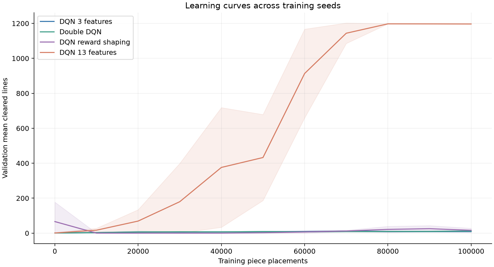
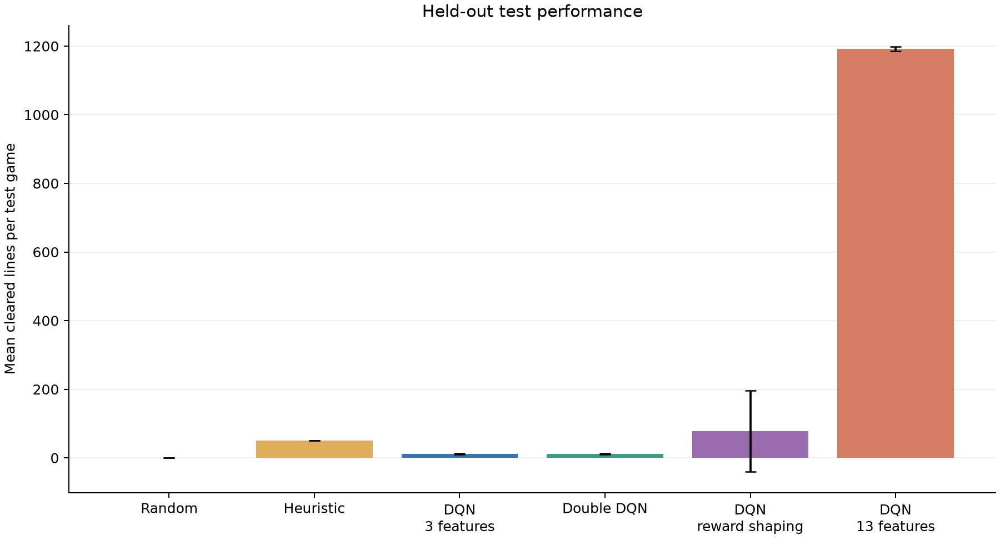
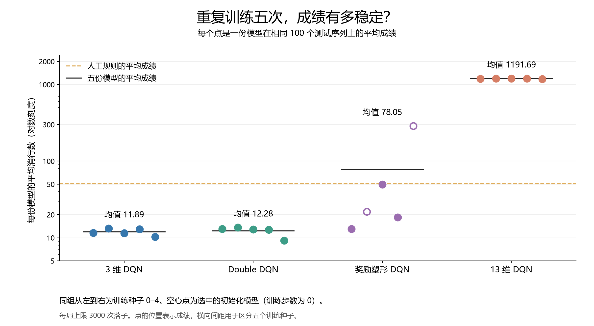
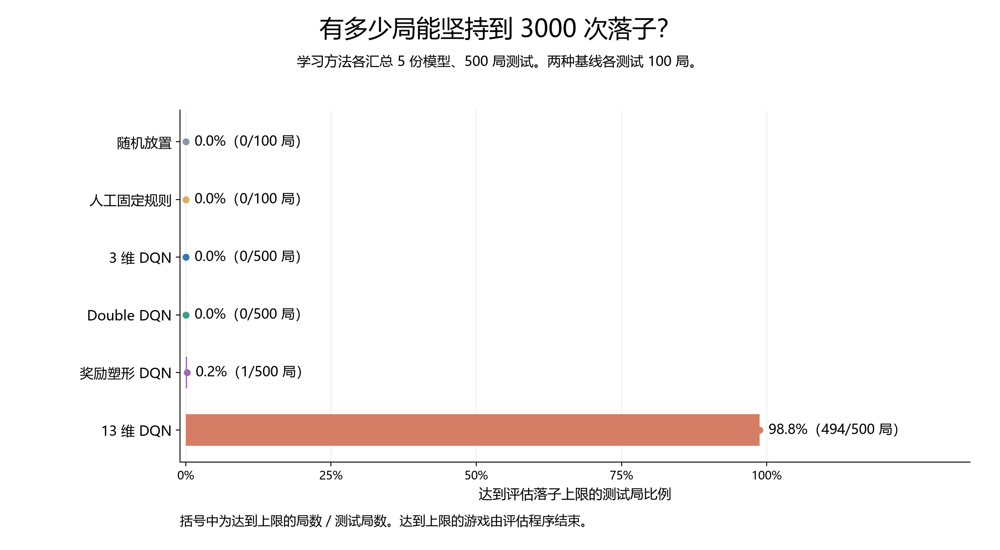
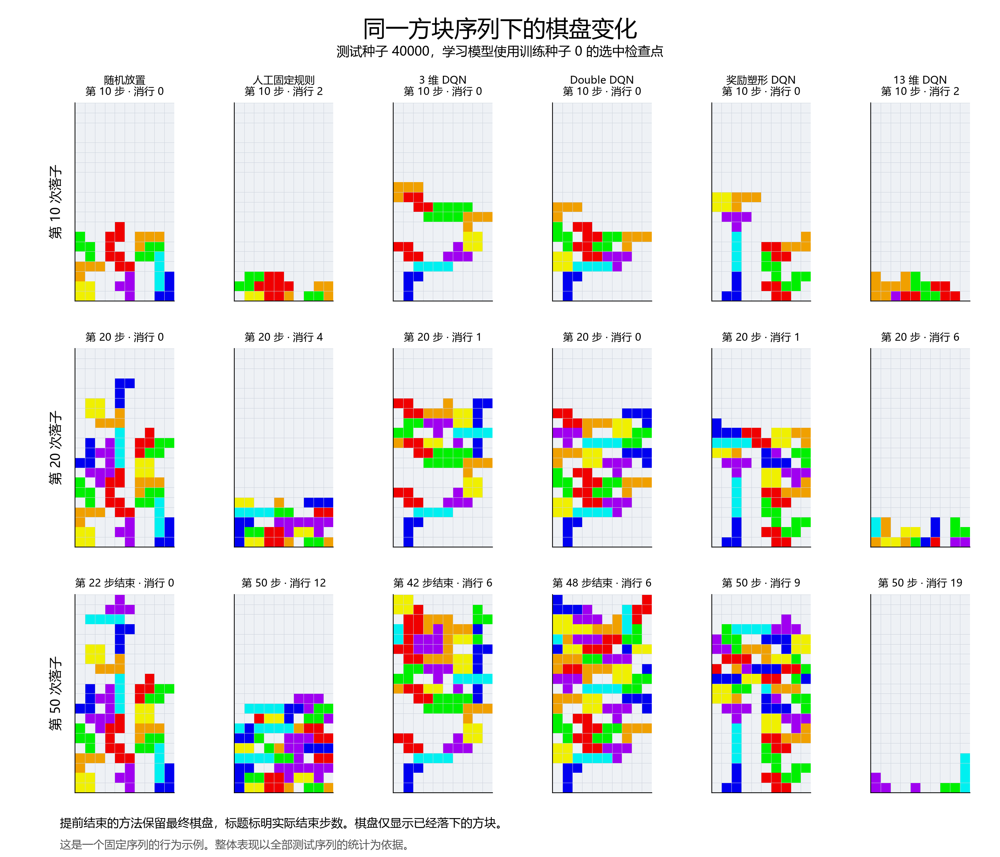
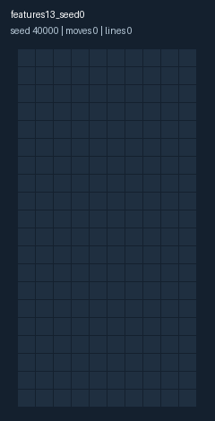

# 本次实验结果

这个项目让程序学习俄罗斯方块的落子选择。我们比较了随机放置、人工固定规则和四种学习配置，完成了 20 次正式训练和 2200 局独立测试。

浏览器登录 GitHub 并接受仓库协作邀请后，可以直接查看本页、图表和演示。代码运行所需的环境见[项目安装说明](../../README.md)。

## 成绩

所有方法使用同一批 100 个测试方块序列，每局上限为 3000 次落子决策。每种学习配置独立训练 5 次，再对这 5 份模型的测试平均值进行汇总。

| 方法 | 平均消行数 | 用来研究什么 |
|---|---:|---|
| 随机放置 | 0.01 | 随机选择合法落点的参考水平 |
| 人工固定规则 | 50.51 | 人写的简单经验能达到什么水平 |
| 3 维 DQN | 11.89 | 使用最高高度、空洞数、凹凸度时的学习效果 |
| Double DQN | 12.28 | 改变后续收益计算方式的效果 |
| DQN＋奖励塑形 | 78.05 | 加入高度和空洞相关奖励后的效果 |
| 13 维 DQN | **1191.69** | 增加十列高度信息后的效果 |

13 维版本的跨训练标准差为 7.01，98.8% 的测试局达到 3000 次落子上限。奖励塑形组的跨训练标准差为 117.80，其中两份最终选中的模型来自训练前的初始化检查点。

[完整报告](../../report/results.md)列出了每个训练种子的成绩、训练前后的验证表现、实验设置和解释范围。

## 图表

### 训练过程中成绩怎样变化



横轴为已经进行的训练落子次数，纵轴为固定验证方块序列上的平均消行数。曲线对 5 次训练取平均，阴影表示训练之间的波动。

### 各种方法的测试成绩



学习方法的误差线表示 5 个训练种子的标准差。基线的逐局波动见完整报告。

### 重复训练五次，成绩是否稳定



每个点是一份选中模型在 100 局测试中的平均消行数，同组从左到右对应训练种子 0 到 4。纵轴采用对数刻度，黑色短线表示五份模型的平均成绩。空心点表示选中的初始化模型，对应奖励塑形组的种子 1 和 4。

奖励塑形组的五次成绩从 13.07 到 287.25 行，13 维组从 1182.39 到 1197.62 行。完整数值和模型所处的训练步数见随图数据。[下载 PDF](figures/training_seed_scores.pdf) · [查看数据](training_seed_scores.csv)

### 有多少局达到 3000 次落子上限



13 维 DQN 的 500 局测试中，494 局达到上限，占 98.8%。奖励塑形组为 1/500 局，占 0.2%。其余方法的测试局均在到达上限前结束。每根柱子旁同时标注实际局数和测试总局数，达到上限的游戏由评估程序结束。[下载 PDF](figures/cap_hit_rates.pdf) · [查看数据](cap_hit_rates.csv)

### 同一个方块序列，棋盘怎样变化



六种方法使用测试种子 40000，四种学习方法使用训练种子 0 的选中模型。三行分别对应第 10、20、50 次落子。提前结束的方法保留最终棋盘，并标明实际结束步数。这个固定序列用于观察落子行为，整体表现见全部测试序列的统计。

生成时将六种方法完整重放到正式评估的结束位置，逐一核对最终消行数、落子次数、奖励和结束方式，并核对共同存活阶段的方块序列。棋盘矩阵、颜色、模型来源与逐步消行数随图保存。[下载 PDF](figures/board_comparison.pdf) · [查看棋盘数据](board_comparison.json)

## 游戏演示

下面展示训练种子 0 的 13 维模型，使用固定测试种子 40000。演示上限为 500 次落子，正式成绩表使用每局 3000 次落子的评估上限。



- [13 维 DQN 的 MP4](videos/features13_seed0.mp4)
- [3 维 DQN 的 MP4](videos/dqn_seed0.mp4)
- [人工规则的 MP4](videos/heuristic.mp4)
- [随机放置的 MP4](videos/random.mp4)

## 数据和模型

- [配置级汇总表](summary.csv)
- [2200 局测试的逐局记录](episodes.csv)
- [正式批次的来源记录](provenance.json)
- [五次训练的模型成绩与选中步数](training_seed_scores.csv)
- [达到评估上限的局数](cap_hit_rates.csv)
- [棋盘对照的原始矩阵与重放核验](board_comparison.json)
- [正式模型、训练日志和配置](../../runs/formal_v1)
- [13 维模型种子 0 的参数文件](../../runs/formal_v1/dqn_features13_seed0_attempt1/best.pt)

准备继续修改代码时，可以按[队友协作指南](../../CONTRIBUTING.md)安装环境、建立分支并记录新的实验。

## 重新生成补充图表

在项目根目录运行以下命令，读取正式批次记录和模型，生成三张图的 PNG、PDF 和数据文件。

```powershell
.\.venv\Scripts\python.exe scripts/plot_additional_results.py --batch runs/formal_v1 --output results/final
```
