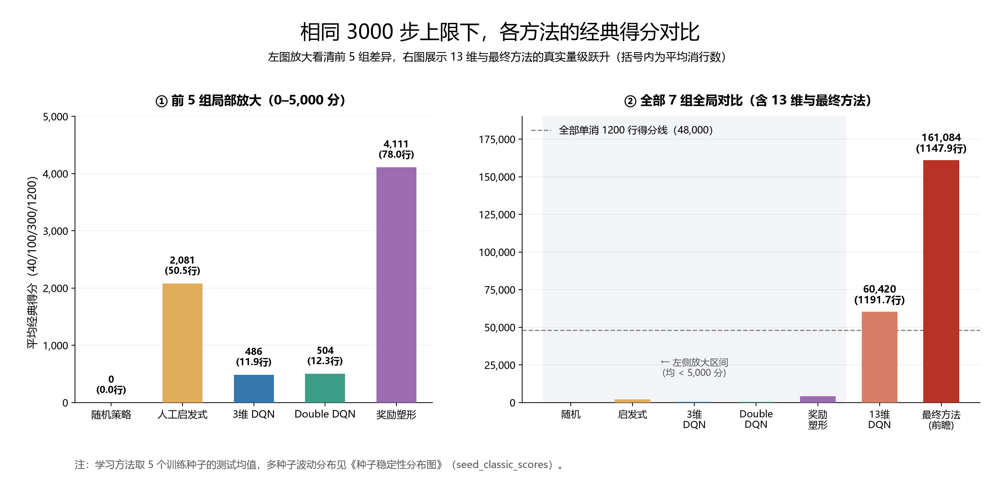
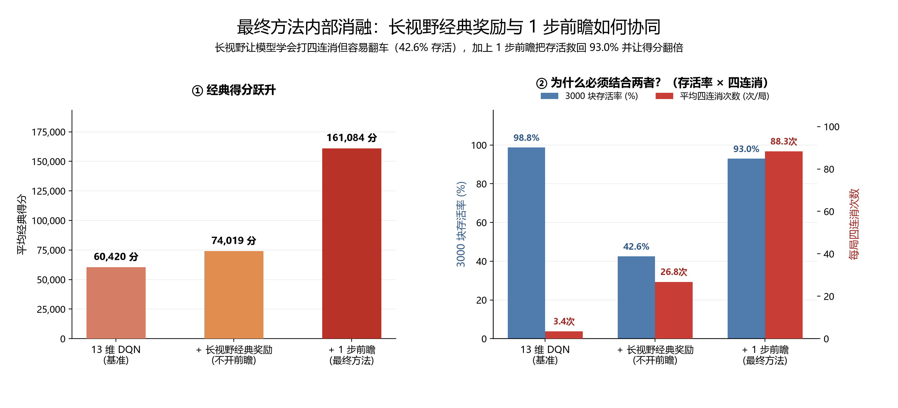
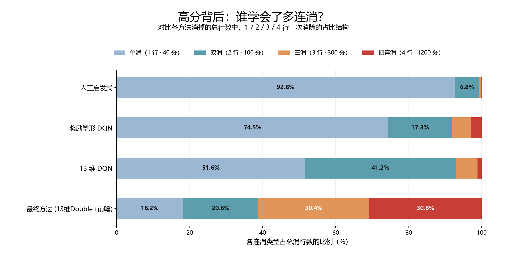
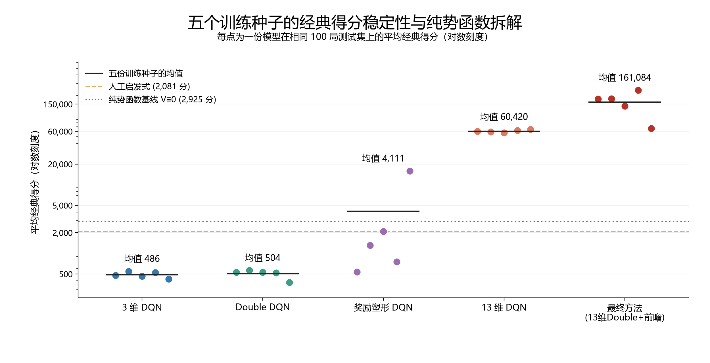
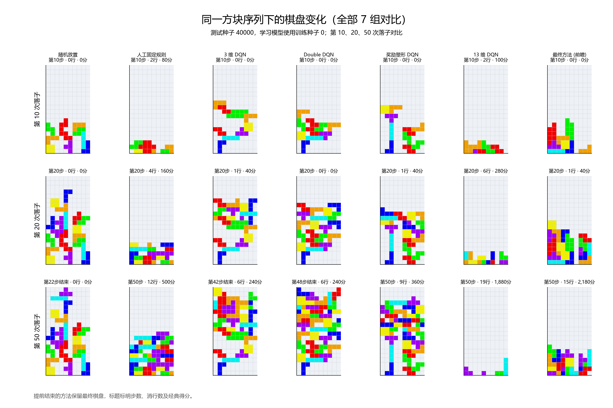
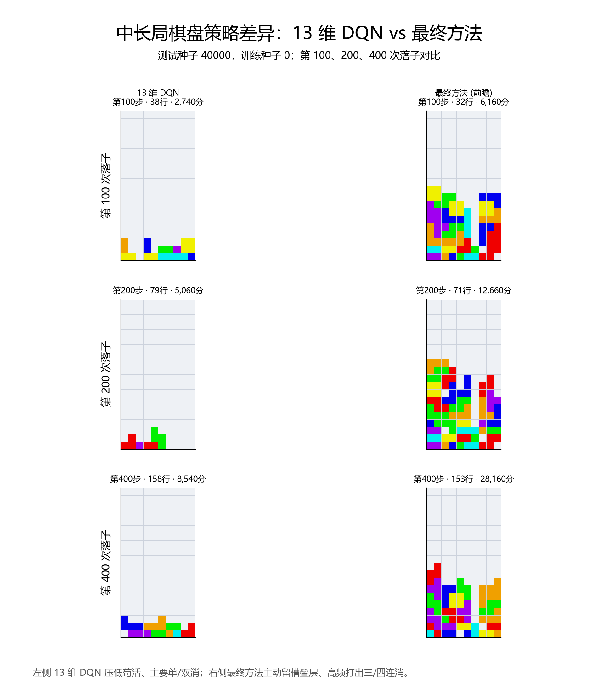
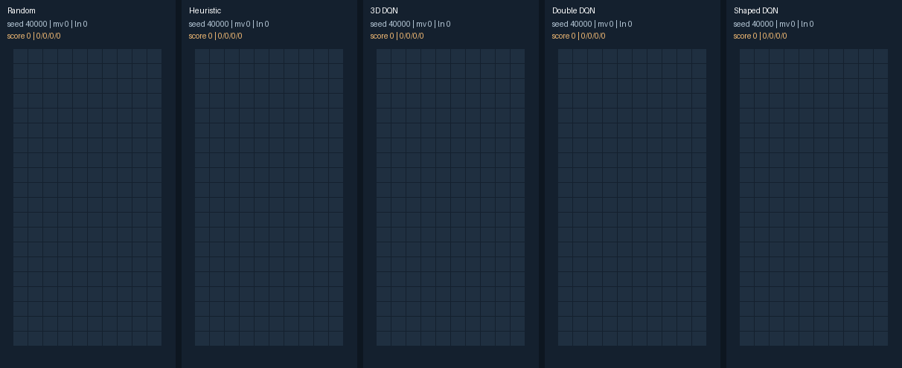
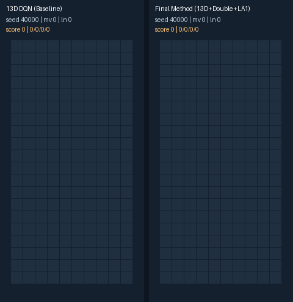

# 终版实验结果与可视化素材清单（v2）

本目录汇总了引入**经典俄罗斯方块得分（`40/100/300/1200`）**、**纯势函数基线（$V \equiv 0$）**与**最终方法（13 维 Double DQN + $\gamma=0.99$ + 经典奖励 + 1 步前瞻）**后的完整评估数据、图表与演示视频。

所有方法均在相同 100 个测试种子（`40000–40099`）、每局 `3000` 块上限下评测。

---

## 一、核心指标总表

| 方法 | 训练种子数 | 平均经典得分 ± 标准差 | 平均消行数 | 3000 块存活率 | 1/2/3/4 连消次数（次/局） | 原奖励 `return` |
|---|---:|---:|---:|---:|---:|---:|
| 随机策略 | 0 | 0.4 ± 4.0 | 0.01 | 0.0% | 0.0 / 0.0 / 0.0 / 0.0 | 7.5 |
| 人工启发式 | 0 | 2,081.4 ± 993.3 | 50.51 | 0.0% | 46.8 / 1.7 / 0.1 / 0.0 | 702.5 |
| 3 维 DQN | 5 | 486.4 ± 49.5 | 11.89 | 0.0% | 11.1 / 0.4 / 0.0 / 0.0 | 173.6 |
| Double DQN（3 维） | 5 | 504.0 ± 73.4 | 12.28 | 0.0% | 11.4 / 0.4 / 0.0 / 0.0 | 180.5 |
| 奖励塑形 DQN（3 维） | 5 | 4,111.2 ± 6,607.7 | 78.05 | 0.2% | 58.1 / 6.8 / 1.3 / 0.6 | 1,283.2 |
| *纯势函数基线（$V \equiv 0$）* | 0 | *2,925.4 ± 2,793.2* | *48.21* | *0.0%* | *31.0 / 5.3 / 1.4 / 0.6* | *882.5* |
| 13 维 DQN | 5 | 60,420.1 ± 2,674.0 | **1,191.69** | **98.8%** | 615.4 / 245.7 / 23.8 / 3.4 | 21,652.0 |
| *最终方法（不开前瞻）* | 5 | *74,018.6 ± 27,440.9* | *808.54* | *42.6%* | *279.7 / 114.8 / 64.1 / 26.8* | *19,485.4* |
| **最终方法（+ 1 步前瞻）** | 5 | **161,083.7 ± 63,617.4** | **1,147.94** | **93.0%** | **208.7 / 118.3 / 116.5 / 88.3** | **34,317.0** |

原始数据文件：[summary.csv](summary.csv) · [training_seed_scores.csv](training_seed_scores.csv) · [episodes.csv](episodes.csv)

---

## 二、图表展示（PPT 可直接拖拽使用，同目录均附 `.pdf` 矢量版）

### 1. 7 组方法经典得分总对比（左图放大前 5 组，右图全局对比）

### 2. 最终方法内部消融：长视野经典奖励 × 1 步前瞻如何协同

### 3. 高分背后的秘密：1 / 2 / 3 / 4 连消占比结构

### 4. 五个训练种子的稳定性与纯势函数基线拆解

### 5. 同方块序列棋盘变化（全 7 组前 50 步 & 中长局 100–400 步特写）

---

## 三、演示视频与动图（测试种子 `40000`，顶部均带实时得分与连消次数）

### 1. 前 5 组基础方法同屏对比（116 帧，全员结束后定格）

- 高清视频：[comparison_first5.mp4](videos/comparison_first5.mp4)

### 2. 后 2 组强方法同屏 PK（500 块完整对局：`10,360` 分 vs `35,780` 分）

- 高清视频：[comparison_13d_vs_final.mp4](videos/comparison_13d_vs_final.mp4)

### 3. 全部 7 组同屏 & 单人带分独立文件
- **7 合 1 全景版**：[comparison_all7.mp4](videos/comparison_all7.mp4) · [comparison_all7.gif](videos/comparison_all7.gif)
- **7 个单人独立带分版（`.mp4` / `.gif` 成对提供）**：
  - [random_score.mp4](videos/random_score.mp4)（22 块 · 0 分）
  - [heuristic_score.mp4](videos/heuristic_score.mp4)（115 块 · 1,180 分）
  - [dqn_seed0_score.mp4](videos/dqn_seed0_score.mp4)（42 块 · 240 分）
  - [double_dqn_seed0_score.mp4](videos/double_dqn_seed0_score.mp4)（48 块 · 240 分）
  - [dqn_shaped_seed0_score.mp4](videos/dqn_shaped_seed0_score.mp4)（57 块 · 400 分）
  - [features13_seed0_score.mp4](videos/features13_seed0_score.mp4)（500 块 · 199 行 · 10,360 分）
  - [final_method_seed0.mp4](videos/final_method_seed0.mp4)（500 块 · 191 行 · **35,780 分** · 23 次四连消）
- 演示详细帧数与得分统计：[videos/demo_metadata.json](videos/demo_metadata.json)
